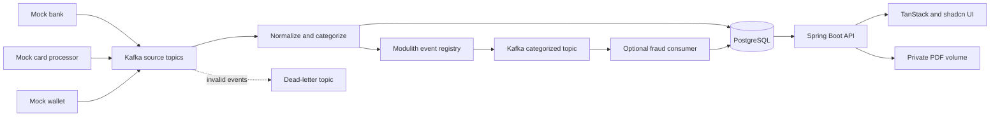
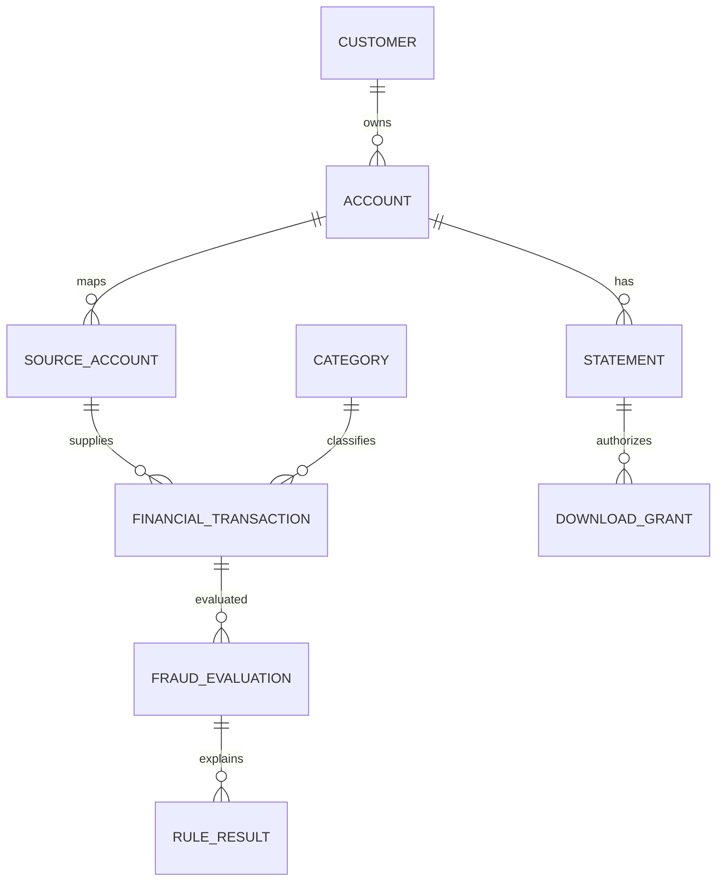

# Transaction aggregation demo

**Chosen assessment: Project 1 — Transaction Aggregation API.** Java owns normalization, categorization, persistence, authorization and retrieval. Fraud evaluation (Project 2) and private PDF delivery (Project 3) are optional modules in the same application. The core runs independently of both extensions.

Three Java mock providers publish different transaction formats to Kafka. A Spring Boot modular monolith aggregates their transactions across all authorized accounts. A TanStack/React interface uses a shadcn sidebar for Overview, Transactions, Fraud checks, Fraud rules, Statements, and an operator testing workspace.

See the [requirement-by-requirement assessment](docs/requirements.md), [business-code review](docs/business-code-review.md), and [executed verification record](docs/verification.json).

The [workspace research and reviewed mockups](docs/design/workspace-v2/README.md) explain the route responsibilities and Capitec visual references. Transactions supports description/reference search, inclusive minimum/maximum amounts and CSV export of the filtered result. Fraud checks supports priority filtering and recorded review outcomes. Statements includes a persistent active-link manager for revocation after navigation or reload.

The default **Overview** route shows transaction count/value trends, spending by category, fraud review status and incoming transactions by source. Choose Today, 7 days or 30 days and optionally an account. Charts refresh every three seconds while active; pause/resume and manual refresh are available. Each chart has an exact-value table. Drilldowns retain the selected account and date cohort. Receipt-time activity is separate from payment-time trends. See the [route-by-route UX decisions and references](docs/route-experience.md), including the generated visual concept.

## Build and run

Install Docker with Compose **2.24.4 or newer** and start the Docker engine. No host Java, Maven, Node or database installation is needed. Initial builds download dependencies; allow roughly 6 GB of Docker memory and sufficient space for Java/Playwright images.

```sh
docker compose up --build -d --wait
```

Open **http://localhost:8080**. The frontend is built into the Spring Boot image and served from the same origin.

| Username | Password | Access |
| --- | --- | --- |
| `operator` | `operator-demo` | Both customers; upload statements |
| `amina` | `customer-demo` | Amina's account and statements |
| `ben` | `customer-demo` | Ben's account and statements |

These are synthetic, local demo identities. The `demo` profile creates them only when absent. Changing password environment variables does not reset existing users in a persisted database.

```sh
docker compose ps
docker compose logs --tail=100 app
docker compose down
```

Normal shutdown retains database, Kafka and PDF volumes. Copy `.env.example` to `.env` for optional configuration. The database and Kafka have no host ports; the application binds to localhost. To build the application image independently: `docker build -t financial-demo .` (the default Dockerfile target is the application).

For the chosen assessment alone:

```sh
docker compose -f compose.yaml -f compose.core.yaml up --build -d --wait
```

This disables the fraud listener/APIs and statement APIs, and hides their navigation links. Return to the full application with the ordinary Compose command.

## Demo flows

1. Sign in as `operator`. Transactions initially shows **all authorized accounts**, with the account beside each transaction. Use the optional Account filter to narrow the view. Amina's seed transactions are salary **R25,000.00**, groceries **R842.50**, and card spending **R5,100.00**; Ben's seed salary is **R12,000.00**. Each source then publishes varied purchases or transfers every five seconds, alternating between both accounts. Latest transactions, totals and fraud results refresh every three seconds. Older transaction pages pause polling. These are transaction totals, not account balances.
2. Open **Fraud checks** and select a payment row, such as GadgetHub. Its debit exceeds the demo threshold of R5,000.00. The side sheet shows payment details and matched reasons. Add a review note and select **Mark as reviewed**; use the Review status filter to find outstanding or completed reviews. The original evaluation and its evidence remain immutable.
3. Open **Fraud rules** as an operator. Configure rolling transaction counts, cumulative amounts, new-beneficiary transfers, overseas online purchases, or simpler amount/merchant/category rules. Select **Edit rule** to set windows and severity, enable/disable or remove a rule. Close the editor with **Done**, then select **Save rules** to apply all changes. New evaluations use the saved version; old evaluations retain their original criteria. See the rule semantics below.
4. Open **Statements**, choose the upload account and upload an unencrypted PDF up to 10 MB (a [synthetic sample](docs/examples/sample-statement.pdf) is included), then create a download link. The link can be downloaded without a session for five minutes, or revoked immediately with **Revoke download link**. Only an authorized account user can issue it. Browse older documents with **Next page**. PDFs are kept in a private Docker volume, never under static web assets.
5. Open **Testing** as an operator to pause sources, publish controlled transaction scenarios, inspect fraud evidence and query aggregation APIs. The separate route is **http://localhost:8080/testing**. The full API contract is also available at **http://localhost:8080/api-docs**. Sign in as `ben` to see account isolation: all accounts means all accounts authorized for that user.

Default producers publish deterministic seed events on startup, then continuously publish new events with unique business references and current timestamps every five seconds per source. Restarting safely replays the seeds. Set `EMIT_INTERVAL_MS` in `.env` to change the interval and recreate the source services; `0` selects seed-only mode. The accelerated stream varies amounts, merchants, MCCs and channels and periodically includes overseas ecommerce and newly created beneficiaries. It is an exercise workload, not a simulation of normal customer spending frequency. Acceptance tests explicitly use seed-only mode for exact totals, then enable a faster stream to verify automatic browser updates. Seed event dates are **9 November 2026**; use an explicit date range to find them after they fall outside the default rolling year. Captured API examples show a recorded snapshot of the running demo; live totals keep changing.

## Testing workspace

### Investigation APIs

`GET /api/v1/transactions`, `/transaction-summary`, `/breakdowns` and `/transactions/export` share account/customer/date/category/source/direction filters plus `q`, `minAmount` and `maxAmount`. Search is a case-insensitive literal substring of description, source reference or payment reference (maximum 120 characters). Amount bounds are inclusive, non-negative decimals with at most two decimal places. Money remains an exact decimal string in JSON.

Example: `/api/v1/transaction-summary?source=CARD_PROCESSOR&direction=DEBIT&q=Gadget&minAmount=5000.00`. The CSV endpoint uses the same account authorization and filters, returns a no-store attachment, quotes fields and neutralises spreadsheet formulas. It rejects more than 10,000 matching rows with 422; narrow the filters instead of accepting a truncated export.

`GET /api/v1/fraud-evaluations` accepts `severity=ALL|HIGH|MEDIUM|LOW|NONE` alongside review status and date/account scope. `POST /api/v1/transactions/{id}/fraud-review` accepts `{ "note": "Customer verified the purchase.", "outcome": "CLEARED" }`. Outcomes are `REVIEWED`, `CLEARED`, `ESCALATED`; omitting outcome retains the earlier `REVIEWED` behaviour. Reviews are operator-only and append-once. These are recorded dispositions, not payment blocking, external case creation or notifications. The original automated decision remains unchanged.

`GET /api/v1/statements/{id}/download-links` returns active-link metadata (`id`, `issuedBy`, `createdAt`, `expiresAt`) with up to 25 items, `nextCursor` and `asOf`. Follow `cursor` for older active links. Account authorization applies to listing and revocation. Secret URLs and hashes are never returned by this endpoint; the URL is available only when issued. Expired/revoked links disappear from the list and cannot download the file. Use **Manage links** beside a statement to revoke an active grant after reloading the page.

### Controlled events and source controls

The `/testing` route and `/api/v1/testing/**` controls require an operator session. The backend controllers exist only under the `demo` Spring profile, and mutations require CSRF tokens. This is a development/testing facility for the single-instance Docker demo.

1. **Pause sources** to stop new automatic events. Accepted events can still finish processing. **Start sources** applies the selected interval to all three providers (500–60,000 ms per source).
2. Under **Events**, choose an ordinary payment, high-value payment, rapid payments, cumulative spend, new beneficiary or overseas online purchase. Adjust the account, source, amount, direction, payment context and batch size (1–20). Event-time spacing changes the timestamps in a batch; it does not delay publication. Blank event time uses the current UTC time.
3. **Send events** publishes provider-specific version-2 envelopes through the real Kafka topics. Broker acknowledgement is shown separately from ingested transactions and fraud decisions. Select a resulting row to inspect the saved rule criteria and evidence. Scenarios do not change saved rules: adjust values or configure rules to test your chosen boundaries. **Replay last batch** keeps the exact references, timestamps and payment facts to test duplicate delivery. If acknowledgement is uncertain, check the results before replaying.
4. **API explorer** runs authenticated GET requests against the existing transaction list, summary and grouped breakdown APIs. It shows the request URL, response status, elapsed time, JSON body and cursor pagination. Account, customer, dates, source, direction and category filters are sent directly to the real APIs.
5. **Transactions → Pause list** freezes automatic refresh of this workspace's latest-ten view. It does not stop ingestion; **Resume list** resumes polling. Source controls are separate.
6. **Reset all transactions** requires typing `RESET` in the confirmation dialog. It pauses all sources, clears **all** transactions, fraud evaluations, rule results, review notes and associated event publications, then leaves sources paused. Accounts, saved fraud rules, PDF statements and download links are retained. The reset is audited with operator, time and deleted transaction count.

| Method | Endpoint | Purpose |
| --- | --- | --- |
| GET | `/api/v1/testing/sources` | Status and interval of each mock source |
| PUT | `/api/v1/testing/sources` | Set `{ "paused": true, "intervalMs": 5000 }` for all sources |
| POST | `/api/v1/testing/events` | Publish a bounded event batch; return acknowledgement metadata and envelopes |
| GET | `/api/v1/testing/events/{requestId}` | Observe ingestion and fraud outcomes for a submitted batch |
| POST | `/api/v1/testing/reset` | Clear demo transaction data with `{ "confirmation": "RESET ALL TRANSACTIONS" }` |

An [example event request](docs/examples/testing-event-request.json) can be posted to `/api/v1/testing/events` with an operator session and CSRF header. Use a fresh UUID for each new scenario; reuse the exact body to replay it. Set an appropriate event time for date-filtered API queries. Money is a decimal string, and the selected source determines whether the generated envelope uses a decimal amount, integer minor units or a signed amount.

Reset first waits for acknowledged source pauses, then takes exclusive access against ingestion, categorized publication and fraud processing. It records the current end offsets of all four transaction topics and deletes database rows in one transaction. Consumers skip records older than those persisted cutoffs, including after an application restart. Queued asynchronous publications check that their transaction still exists. Kafka records and dead-letter topics are retained; reset does not purge the broker. If a source cannot be paused, reset returns 503 without deleting data; some sources may already be paused, and their status is shown. This local processing gate is intentionally **not a multi-instance reset protocol**.

Each provider exposes a small `/control` endpoint only on the Compose network, authenticated with the shared `MOCK_CONTROL_KEY`; there are no host ports. Runtime pause/rate settings are in memory. Restarting a source restores its Compose interval and republishes deterministic seed events, so seeds can appear again after a reset. Reset currently selects a 5-second interval while pausing; choose the desired interval before restarting the stream. Stop/restart and reset are explicit demo operations, not financial data retention features.

## Run all checks

Windows PowerShell:

```powershell
powershell -NoProfile -ExecutionPolicy Bypass -File scripts/verify.ps1
```

Linux/macOS:

```sh
sh scripts/verify.sh
```

These scripts build and test through Docker/Compose. They reset **only** the dedicated `financial-demo-test` project and its disposable volumes; the normal demo is preserved. Do not use that reserved project name for personal data. Port 18080 must be free. Test users/passwords and the three-second test link lifetime are isolated overrides.

The suite checks:

- Java normalization, decimal validation, categorization, fraud boundaries and Spring Modulith dependency rules.
- Real Kafka → PostgreSQL → API integration, all three providers, exact totals, duplicate deliveries, conflicting identities and malformed-event dead letters.
- Overview reconciliation, account/date drilldowns, pending checks, receipt-time arrivals, live pause/resume and refresh-error recovery. Four dependency-free frontend tests cover quiet buckets, South African midnight, exclusive range ends, accepted future buckets and exact monetary strings; Docker runs them with Node 24.
- API pagination, invalid parameters, CSRF and cross-customer authorization.
- Aggregation across accounts, account grouping and shared breakdown filters; operator-only rule editing, invalid/stale saves, immutable revision history, disabled/category rules and replay across configuration changes.
- Chromium login, filtering, fraud explanation, PDF upload/download and logout; desktop/mobile screenshots and browser errors.
- Invalid PDFs, token tampering, customer isolation, hashed token storage, revocation and real server-side expiry.
- Queued-event processing after application restart, a database outage and producer replay.
- Continuous publication from all three real mock source containers, with new browser rows and totals appearing without a manual refresh.
- Aggregation API and browser navigation with both optional modules disabled.
- Testing workspace access, validation, source pause/resume, all-data reset and preserved accounts/rules/statements; Kafka offset rewind across restart, refusal to reset when a source is unavailable, event replay, contextual/velocity scenarios, live-list pause and API explorer responses on desktop/mobile.
- Malformed cursor timestamps, statement pagination and scope, default transaction date ranges across midnight, supplied merchant names in reports, private-file cleanup and checksum validation.
- File-route preloading, parallel list/summary/reference queries, accessible skeletons, retry after a reporting outage, browser link revocation and cache isolation when changing users.

Artifacts remain in `test-results/`: screenshots, Playwright HTML report, failure traces and service logs. The suite exits nonzero on failure and tears down test services. GitHub Actions is configured to run the same shell script and upload these artifacts.

For focused Java checks: `docker compose --profile test run --rm --build --no-deps backend-tests`. With Java 21 installed, `./mvnw verify` (Windows `mvnw.cmd verify`) also works. Java formatting is `./mvnw spotless:apply`, validation is `./mvnw spotless:check`. Frontend development uses `npm ci`, `npm run dev` and `npm run build` inside `frontend/`; Vite proxies API requests to the running backend on port 8080.

## Architecture and decisions



- **Java 21, Spring Boot 3.5, Spring Modulith 1.4.** Package modules are `accounts`, `transactions`, `ingestion`, `fraud`, `statements` and `platform`. A module verification test prevents undeclared dependencies and cycles.
- **Spring Data JDBC + PostgreSQL + Liquibase.** Typed aggregate records and Spring Data repositories own persistence. Simple documents and grants use framework `save` and optimistic version fields; idempotent transaction/evaluation inserts use explicit repository queries. Dynamic reporting SQL lives in one Spring Data repository fragment. Controllers and business services do not execute SQL. Boot configures the pool, transactions, Jackson, Kafka, Security and Actuator.
- **Spring Modulith publication registry.** A transaction and its categorized event publication are saved in one database transaction. The listener publishes to Kafka and waits for acknowledgement before completion. Incomplete publications are retried every 30 seconds and on restart; completed records are retained for seven days.
- **At-least-once delivery with idempotent writes.** Raw Kafka offsets advance after the database transaction returns. A unique `(source_account_id, source_transaction_ref)` constraint handles redelivery; a normalized content hash detects conflicting reuse of that identity. Fraud results are unique per transaction and retain the selected ruleset version. Replays cannot silently apply newer rules. This is not an exactly-once claim across Kafka and PostgreSQL.
- **Explicit failure policy.** Database connection/transient failures keep retrying. Permanent malformed records are published to a dead-letter topic; an offset is not considered recovered until dead-letter publication succeeds. Other unexpected failures get three retries. Topic retention is seven days. Replay/retention monitoring is an operational responsibility.
- **A small frontend.** TanStack Router owns navigation/search state; TanStack Query owns server state and mutation invalidation. shadcn components supply the responsive sidebar, rule switches, form fields, buttons, selects, tables, alerts and empty/loading states. No extra client state store or separate frontend runtime is needed in deployment.
- **Kafka is the ingestion boundary.** NiFi, Flink, Redis and additional microservices are unnecessary for these stateless adapters and bounded configurable fraud templates backed by indexed PostgreSQL history queries. Rule types are allowlisted Java predicates, with data stored in PostgreSQL; no expression interpreter or arbitrary scripts are executed.

## API

`GET /api/v1/overview?days=7&accountId=<optional UUID>` returns a consistent, authorized report: `asOf`, `from`, `toExclusive`, `bucket`, `receivedFrom`, `transactions` (totals, activity, spending, arrivals, lastReceivedAt), and `fraud` (notFlagged, needsReview, reviewed, pending, highPriority). Periods are limited to 1/7/30 South African calendar days. Arrivals cover the last 15 minute buckets regardless of payment date. Empty series are valid; fraud is null when disabled. Exact amounts are decimal strings. This reports observed data, not a broker watermark or provider health check.

Fraud evaluation lists additionally accept a paired `from`/`toExclusive` payment-date range (maximum 366 days), with `reviewStatus=ALL|NEEDS_REVIEW|REVIEWED`. This lets overview drilldowns retrieve the same transaction cohort.

Sign in in the browser, then open **http://localhost:8080/api-docs** for Swagger UI (operator access). The OpenAPI document is `/v3/api-docs`. The running schema is authoritative; concrete captured examples are in [`docs/examples/api-examples.json`](docs/examples/api-examples.json).

For scripted clients, GET `/api/csrf` and retain its session cookie. POST URL-encoded `username` and `password` to `/api/session`, with the returned token in its `headerName`. Retrieve a fresh CSRF token after login and include it in each POST/DELETE. GET requests only need the session cookie. POST `/api/session/logout` ends the session.

| Endpoint | Purpose |
| --- | --- |
| `GET /api/v1/customers` | Customers visible to the current user |
| `GET /api/v1/accounts` | Visible accounts |
| `GET /api/v1/overview` | Bounded account-scoped totals, transaction activity, category spending, receipt-time arrivals and fraud status |
| `GET /api/v1/customers/{id}/accounts` | Customer accounts |
| `GET /api/v1/transactions` | Filtered, cursor-paginated transactions |
| `GET /api/v1/transactions/{id}` | Authorized transaction detail |
| `GET /api/v1/transaction-summary` | Counts, money in/out, net movement and category totals |
| `GET /api/v1/customers/{id}/transaction-summary` | Customer totals |
| `GET /api/v1/accounts/{id}/transaction-summary` | Account totals |
| `GET /api/v1/breakdowns` | `groupBy=CATEGORY`, `MERCHANT`, `SOURCE`, `ACCOUNT`, `DAY` or `MONTH` |
| `GET /api/v1/categories` | Category reference data |
| `GET /api/v1/fraud-evaluations` | Completed results, scoped pagination and review-status filtering |
| `GET /api/v1/transactions/{id}/fraud-evaluation` | Persisted rule versions, observations and explanations; PENDING until a decision exists |
| `GET /api/v1/fraud-rules` | Active rule configuration (operator only) |
| `PUT /api/v1/fraud-rules` | Atomically save a new revision with `expectedVersion` (operator only) |
| `GET /api/v1/fraud-rules/{version}` | Immutable configuration history (operator only) |
| `GET /api/v1/statements` | Cursor-paginated authorized statements; optional accountId, limit and cursor |
| `POST /api/v1/statements` | Operator multipart upload: `accountId`, `file` |
| `POST /api/v1/statements/{id}/download-links` | Issue a temporary bearer link |
| `DELETE /api/v1/download-links/{id}` | Revoke a link |
| `GET /downloads/{token}` | Anonymous bearer download, checked on every request |

Transaction list, summary and breakdown filters: `accountId`, `customerId`, `from`, `toExclusive`, `category`, `source`, `direction`. Omit account/customer filters for all authorized accounts. Customer/account summary aliases accept the two dates. Breakdowns also accept `groupBy`; ACCOUNT bucket names are account UUIDs, resolved through `/api/v1/accounts`. Fraud lists accept account/customer scope, limit and cursor. List limits are 1–100 (default 25); follow `nextCursor` with unchanged filters. Dates are South African calendar dates, from inclusive/until exclusive, maximum 366 days. API timestamps are UTC. Empty time buckets are omitted; breakdowns exceeding 1,000 groups return 422 and require a narrower range.

MERCHANT groups use the supplied merchant name when payment context exists, falling back to the legacy description when it does not. Statement pages return `{ items, nextCursor, asOf }` ordered by upload time and ID. Transaction cursors retain their original default date range across midnight; changing filters requires a new first page.

Money uses positive `NUMERIC(19,2)`/`BigDecimal`, explicit CREDIT/DEBIT direction, and JSON decimal **strings**. ZAR is the supported currency; amounts are never aggregated across currencies. Unknown merchants remain UNCATEGORIZED. The categorizer uses version 1 for legacy descriptions and version 2 for enriched MCC mapping with description fallback; fraud configuration versions are persisted and increment as operators save changes.

An executable API client is included:

```powershell
powershell -NoProfile -ExecutionPolicy Bypass -File scripts/read-aggregates.ps1
powershell -NoProfile -ExecutionPolicy Bypass -File scripts/read-aggregates.ps1 -GroupBy ACCOUNT
powershell -NoProfile -ExecutionPolicy Bypass -File scripts/read-aggregates.ps1 -AccountId 20000000-0000-0000-0000-000000000001
```

It signs in, retains the session cookie and prints actual JSON from the aggregation API. These commands use the local demo credentials by default; username/password/base URL are configurable parameters.

### Configurable fraud rules

The starter configuration contains six enabled rules: amount above ZAR 5,000, a restricted merchant, more than eight debits in five minutes, cumulative debits above ZAR 50,000 in sixty minutes, a transfer above ZAR 5,000 to a beneficiary created within sixty minutes, and an online card purchase above ZAR 2,500 at a merchant outside ZA. These are illustrative controls, not thresholds calibrated against real fraud data. Migration 004 advances only the untouched starter revision; operator-authored configurations are preserved.

Operators can configure up to twenty rules. Each has a stable code, name, enabled state, direction and LOW/MEDIUM/HIGH review severity. Supported conditions:

| Type | Parameters and semantics |
| --- | --- |
| AMOUNT_GREATER_THAN | This amount strictly exceeds a positive ZAR threshold |
| MERCHANT_EQUALS | Case-insensitive exact merchant name |
| CATEGORY_EQUALS | Existing category code |
| VELOCITY_COUNT | Account transaction count strictly exceeds a threshold in 1–1,440 minutes |
| VELOCITY_AMOUNT | Account total strictly exceeds a ZAR threshold in 1–1,440 minutes |
| NEW_BENEFICIARY_PAYMENT | DEBIT transfer AND amount above threshold AND known beneficiary age at most the configured window |
| FOREIGN_ONLINE_PAYMENT | DEBIT card purchase AND ECOMMERCE channel AND merchant outside the configured ISO home country AND amount above threshold |

Any MATCHED rule produces FLAGGED with action REVIEW; severity is the highest matched rule severity. There is no payment blocking or probabilistic risk score. DISABLED, NOT_APPLICABLE, NOT_MATCHED and INSUFFICIENT_DATA are distinct results. Missing required context yields INSUFFICIENT_DATA and PARTIAL evidence coverage; NOT_FLAGGED is not a claim that a payment is safe. An empty configuration is allowed and flags nothing.

Window evidence uses the same account and currency across its source mappings, the configured direction, and **(transaction time minus window, transaction time]**, including the current transaction. The evaluator reads one PostgreSQL REPEATABLE_READ snapshot, caches repeated window queries within that evaluation, and stores counts, exact sums, bounds and an observation cutoff. The index starts with source account, direction and transaction time. Future-dated history and other accounts are excluded. Late-arriving history can affect subsequent decisions but never rewrites a completed decision. This is evaluation of available history, not a watermark-complete event-time engine.

PUT replaces the whole configuration atomically. Send the version returned by GET as `expectedVersion`; concurrent stale saves return 409. Invalid definitions return 400 and non-operators receive 403. Every successful save creates an immutable revision with author and timestamp. [Example request](docs/examples/rule-update.json).

The active revision is chosen when a transaction is first evaluated, including queued events. That complete snapshot is used for every rule in the decision. Configuration changes do not retroactively reevaluate transactions; replay preserves the original result. Each evaluation retains the revision and every rule's criteria/observations. The legacy `rulesetVersion` field on the categorized event is retained for wire compatibility and is not configuration authority.

Reads are eventually consistent with the Kafka stream. Each summary uses a consistent database snapshot for its totals and categories. List cursors carry a recorded-at cutoff and deterministic `(occurred_at, id)` ordering, but do not hold an MVCC snapshot across HTTP requests: a transaction committing late can become visible on a later page. `asOf` is a query cutoff, not proof that all source events up to that time have arrived. `lastProcessedAt` is the latest stored transaction in that filter scope. No global ordering is promised across provider topics.

## Data model



Field-level diagrams: [transactions](docs/design/erd/01-transactions.mmd), [fraud](docs/design/erd/03-fraud.mmd), [statements](docs/design/erd/04-statements.mmd). The executable schema and constraints live in `backend/src/main/resources/db/changelog/`. Spring Security's `users`/`authorities` tables hold local credentials; Modulith owns `event_publication` semantics. Missing fraud evaluations are reported as PENDING; only completed evaluations are persisted. A dead-lettered fraud event remains pending until an operator resolves/replays it.

## Source contracts

Each source has its own container, topic and adapter. Kafka keys identify the source account. The shared envelope contains `eventId`, `schemaVersion: 1 | 2`, `source`, `sourceAccountRef`, `occurredAt` and `payload`. The provider business transaction reference, not the delivery event ID, defines identity.

| Source/topic | Payload representation |
| --- | --- |
| CORE_BANK / `mock.bank.transactions.v1` | Decimal string `amount`, `creditDebit`, description and reference |
| CARD_PROCESSOR / `mock.card.transactions.v1` | Integer `amountMinor`, direction, merchant and transaction reference |
| WALLET_PROVIDER / `mock.wallet.transactions.v1` | Signed decimal string `signedAmount`, counterparty and reference |

Copyable event fixtures are in [`docs/examples/`](docs/examples/). `transactions.categorized.v1` carries the normalized Java `CategorizedTransaction` record. Raw and categorized invalid events go to `transactions.raw.dlt.v1` and `transactions.categorized.dlt.v1`. Internal topic producers are trusted in this local network; a real deployment needs broker authentication and topic ACLs.

## Reliability, security and performance boundaries

- PostgreSQL constraints and transactions enforce financial identity, exact amounts and atomic evaluation results. Keyset pagination and composite indexes support bounded retrieval; breakdowns run in SQL. The connection pool is 10, ingestion concurrency is 2, and async publication work has a bounded executor. No throughput or latency benchmark is claimed.
- Session authentication uses Spring Security with BCrypt passwords, session fixation protection, HttpOnly/SameSite cookies and CSRF protection. Account ownership is enforced in backend queries/services. Cross-customer resource requests return 404. Local HTTP cookies must become Secure cookies behind HTTPS in deployment.
- Download tokens have 256 bits of randomness; only SHA-256 hashes are stored. Links expire after at most five minutes and can be revoked. Responses are attachment downloads with `no-store` and `no-referrer`. Do not log bearer URLs at a reverse proxy. A download authorized before expiry may finish after it; expiry gates new requests.
- PDF paths are server-generated, uploads are bounded, PDFBox validates readable unencrypted content, and moves are atomic on the same volume. STAGING records reconcile after 15 minutes; stale partial files are cleaned. PDF parsing is not malware scanning. Upload is a trusted operator capability.
- Actuator exposes readiness/liveness and operator-only Prometheus metrics at `/actuator/prometheus`, including HTTP/JVM/Hikari/Kafka metrics and accepted/duplicate/quarantined counters. Readiness includes database connectivity. Readiness does not imply the Kafka backlog is empty. Consumer lag and dead-letter topics should be monitored separately.
- This is a single-instance assessment deployment: one broker, one database and local persistent PDF storage; in-memory sessions and per-instance rate limits. Real banking rollout needs managed identity, TLS, secrets management, redundant brokers/database, backup/restore and retention policies, malware scanning, centralized rate limits and operational alerting. These are stated boundaries rather than claims that Compose is highly available.
- Dependency review: `npm audit --omit=dev` reports zero frontend runtime advisories at verification time. The full audit reports six findings through the shadcn CLI's `deepmerge` and `minimatch` dependencies. These are build/development tooling; the final image contains static frontend assets and no Node installation. No forced downgrade or unverified transitive override is applied. Recheck advisories when updating dependencies; Java dependencies have not undergone a dedicated vulnerability scan in this submission.

## Troubleshooting and submission

- If Docker cannot connect, start its engine. If port 8080 is taken, set `APP_PORT` in `.env`.
- If tables are empty, inspect `docker compose logs bank-source card-source wallet-source app`, wait for processing, then Refresh. Confirm the selected date range includes the events.
- Inspect raw dead letters with `docker compose exec kafka /opt/kafka/bin/kafka-console-consumer.sh --bootstrap-server kafka:9092 --topic transactions.raw.dlt.v1 --from-beginning --max-messages 10`. This may wait if fewer records exist. Resolve the source contract/mapping problem, then publish the corrected original envelope to its source topic. Keep the same provider identity; the application will reject conflicting changes to already-stored financial facts. There is no automatic DLT redrive UI.
- Source-account mappings are explicit seed data; adding a provider account requires a controlled mapping change. The service does not infer account ownership from untrusted payload fields.
- Earlier planning JSON and mock images under `docs/design/` are historical design references, not implemented API contracts or test evidence. This README, source code, Liquibase schema and running OpenAPI describe the delivered application.

Commit this single repository and share its GitHub URL for assessment. No remote repository or deployment is created by these scripts.


## Payment contracts and visual tokens

See [realistic contracts and examples](docs/contracts.md) for the Kafka request, GET query, returned transaction and rule semantics. Version 2 events require a typed `payload.payment` context with BOOKED status, transaction type/channel, booking/value dates and payment reference. Card purchases include merchant ID/name/MCC/country and last-four-only instrument/authentication data; transfers include a counterparty and optional beneficiary creation time. Version 1 remains supported with `payment: null`; no missing facts are invented. Enrichment participates in the idempotency hash, so reusing an identity with changed context goes to the DLT. Provider raw payloads and full card numbers are not stored.

This service aggregates **booked movements**, not pending card authorisations or available balances. It rejects pending/reversed status in the enriched feed; modelling lifecycle updates and linking reversal/refund movements is a separate ledger extension. Mock sources represent disjoint movements. Production feeds with overlapping card/ledger representations need a reconciliation identity before summing them. ZAR only; no fabricated FX conversion. Context is trusted adapter evidence, not a customer assertion. There is no behavioural/ML model, sanctions screening or production fraud calibration.

The transaction detail sheet shows the customer, masked account, payment date, category, payment method, merchant, country, recipient, masked card when supplied. Fraud rows open the same style of side sheet, with matched reasons and persisted review notes. Technical IDs, raw JSON, rule revisions and ingestion details remain in the API, not the workspace.

All application colours live in [frontend/src/index.css](frontend/src/index.css). The current [Capitec public website](https://www.capitecbank.co.za/) informed the royal blue `#2f70ef`, heading blue `#0033a0`, white sidebar/surfaces, light borders and pill buttons. Semantic shadcn tokens keep colours out of feature components. The action token uses a slightly darker blue (`#2865df`) to meet 4.5:1 text contrast; the original brand blue remains available for branding. Nunito Sans is bundled locally; it approximates the public site's typography without redistributing the proprietary heading font. The logo is the public site's SVG, retained for this private assessment presentation. This is an independent assessment application, not an official Capitec product or its internal design system.

## Maintainable structure

Package by business capability, then hide implementation details with Spring Modulith. A request should be traceable through a small controller, a named use case, and a repository. Avoid generic base services, repositories wrapping repositories, and a separate service for each trivial operation.

```text
backend/src/main/java/dev/financial/app/
  overview/internal/                  # authorized snapshot reporting across public module APIs
  accounts/
    AccountAccess.java                 # account authorization and source mapping API
    internal/                         # controller, account record and repository
  transactions/
    CategorizedTransaction.java        # published module event
    PaymentDetails.java               # immutable normalized payment context
    TransactionWriter.java            # idempotent ingestion use case
    TransactionQueries.java           # authorized retrieval and reporting use cases
    TransactionHistory.java           # bounded history API for fraud
    internal/                         # categorizer, HTTP adapter, publisher, repositories
      TransactionReportsImpl.java     # dynamic SQL and projection mapping only
  ingestion/internal/                 # Kafka adapter and provider normalization
  fraud/internal/
    FraudRules.java                    # evaluator registry, eligibility and evidence
    FraudProcessor.java                # validate, evaluate, save one immutable decision
    FraudEvaluationQueries.java        # authorized pages and evidence reads
    FraudReviewService.java            # review command only
    FraudViews.java                    # API response records
    RuleConfiguration.java            # immutable configuration revisions
    rules/                            # pure condition evaluators and config validator
      FraudRuleEvaluator.java         # explicit condition extension point
    persistence/                      # evaluation, evidence, review and ruleset repositories
  statements/internal/
    StatementService.java             # upload and list use cases
    PrivateStatementStorage.java      # bounded file I/O, validation and atomic publish
    DownloadLinkService.java          # issue, revoke and redeem links
    StatementMaintenance.java         # interrupted upload recovery and expired link cleanup
    *Repository.java                  # Spring Data JDBC persistence
  testing/internal/                   # demo-only controls, event composition and audited reset
    TestingService.java               # coordinates sources, Kafka and reset transaction
    MockSources.java                  # bounded HTTP calls to the three fixed source endpoints
    TestEventFactory.java             # deterministic provider-specific envelopes
  platform/                           # Boot, security, Kafka, errors and session setup
    ProcessingGate.java               # local processing lock and persisted reset cutoffs
    PageCursor.java                   # shared keyset cursor validation
frontend/src/
  routes/                             # TanStack file routes and data preload decisions
  features/                           # feature folders: page, queries, editors and sheets
  components/                         # shared account filter, payment facts and shell
    ui/                               # shadcn primitives
  lib/                                # API client, DTO types and display helpers
  index.css                           # shared design tokens
```

Spring Data JDBC aggregates are intentionally small. Transactions, evaluations, evidence rows and reviews are separate records linked by IDs; there is no unbounded child collection that is rewritten when saving an aggregate. Assigned UUID aggregates using `save` have a nullable `@Version` field so Spring recognizes new records. Liquibase owns all schema changes, including the review table and version columns in migration 005. Explicit PostgreSQL `ON CONFLICT` queries preserve duplicate delivery semantics. The only application `JdbcClient` reporting implementation is behind the Spring Data repository fragment; demo identity setup also uses SQL through Spring Security's JDBC infrastructure.

Architecture tests enforce module boundaries and prohibit controllers, services, query facades and processors from depending on `JdbcClient`. Pure rule tests and real Docker integration tests protect behavior during refactoring. Review operations do not alter a historical fraud decision; a duplicate review returns 409. Lists use bounded pages and batched transaction/review lookups, without one query per table row.

The [file-by-file business-code review](docs/business-code-review.md) covers every handwritten production Java file and frontend application source file, with a [hash-bound inventory](docs/business-code-review.json), ownership decisions and concrete extension instructions. `FraudDemoReset` and `TransactionDemoReset` own their module's deletion operations; the demo testing service coordinates them within one transaction. The testing results repository has one deliberate read-only diagnostic join across modules, documented in the review.

This is a **Vite SPA using TanStack Router and Query**, with Spring Boot as the sole server. The Router Vite plugin generates file routes and splits page components into separate bundles. Intent preloading and route loaders use the same `queryOptions` as page components. Independent transaction queries start together, and pages use `useSuspenseQuery`/`useSuspenseQueries` with shadcn skeletons and a retryable error boundary. URL filters support browser history and shared links. Conditional sheet/diagnostic queries retain `useQuery`; replacing those with Suspense would not improve their on-demand behaviour. Latest pages poll while mounted, older cursor pages stop polling, and completed test outcomes stop polling. Session changes clear cached financial data. No SSR server or TanStack Start runtime is added.

The structure follows [Spring Boot's package guidance](https://docs.spring.io/spring-boot/reference/using/structuring-your-code.html), [Spring Modulith module boundaries](https://docs.spring.io/spring-modulith/reference/fundamentals.html), and [Spring Data JDBC aggregate guidance](https://docs.spring.io/spring-data/relational/reference/jdbc/domain-driven-design.html). The [Google code review guide](https://google.github.io/eng-practices/review/reviewer/looking-for.html) is the review standard: understandable control flow, focused responsibilities, useful tests, and no speculative abstractions. File count alone is not a measure of maintainability.

## Throughput and file handling

**Flink is not necessary for the demonstrated requirements. No bank-scale throughput claim is made.** The current load tests exercise correctness and recovery, not capacity. The next step before choosing a streaming engine is a representative benchmark: transactions/second, account skew, window size, p95/p99 evaluation latency, consumer lag, pool wait time, database CPU/I/O, and recovery duration.

| Concern | Current implementation | Scale when measurements justify it |
| --- | --- | --- |
| Ingestion | Kafka buffering, bounded poll size, two Spring Kafka consumer threads, three partitions per topic | Tune partitions and consumer concurrency together, preserving account ordering; budget connections across all instances |
| Persistence | Hikari pool of 10, short transactions, idempotent writes, indexed account/time queries | Query plans, suitable indexes, batched writes with explicit failure semantics; database partitioning/retention after measurement |
| Aggregation API | Indexed SQL with date bounds, keyset pagination, exact decimals | Incremental daily summaries/read models for repeated large-range queries; reconcile totals against source facts |
| Fraud windows | PostgreSQL history at a repeatable-read observation cutoff; late arrivals do not rewrite prior decisions | Kafka Streams for keyed state and windowed aggregation if DB history reads dominate; specify late-event policy first |
| Complex event processing | Not required by this brief | Flink when large keyed state, event-time watermarks, joins, timers, checkpointing and independent stream operations are actual requirements |
| PDF upload/download | Spring multipart limits, bounded streamed writes, file-backed PDF parsing, private volume, `FileSystemResource` response | Private object storage and streaming/multipart SDK upload; bounded scan workers, quarantine/availability states and lifecycle policy |
| Multiple web instances | Current demo is a single application instance | Shared session management, shared/object storage, coordinated cleanup and gateway/distributed rate limits; the current local rate limiter is not cluster-wide |

Spring Boot integrates the pieces; it is not itself a distributed stream processor. [Spring Kafka containers](https://docs.spring.io/spring-kafka/reference/kafka/receiving-messages/message-listener-container.html) provide bounded consumer concurrency, acknowledgements and retry handling. [Spring-managed Kafka Streams](https://docs.spring.io/spring-kafka/reference/streams.html) is a smaller operational step for Kafka-centric window state. [Flink's state and checkpoints](https://nightlies.apache.org/flink/flink-docs-stable/docs/concepts/stateful-stream-processing/) solve a broader problem. More listener threads or virtual threads cannot remove a database bottleneck or provide event-time completeness.

PDFs are not stored as database blobs or loaded entirely into byte arrays for downloads. Upload stages the file, persists STAGING metadata, atomically moves the file, then marks it AVAILABLE. Recovery checks stale metadata and checksums after an interrupted upload. File and database changes cannot be one atomic transaction; that lifecycle makes the gap explicit. [Spring MVC resource responses](https://docs.spring.io/spring-framework/reference/web/webmvc/mvc-controller/ann-methods/responseentity.html) stream downloads. A future direct object-storage signed URL would change immediate revocation semantics, so the current revocable gateway must be retained when immediate revocation is required.

Mock concepts: [transactions](docs/design/capitec-refresh/transactions-concept.png), [fraud review](docs/design/capitec-refresh/fraud-concept.png). These are generated design references; runtime screenshots in `test-results/` show the actual implementation.
