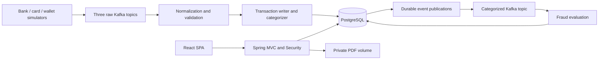

# Architecture

## Scope and decisions

The application aggregates **booked ZAR movements** from three disjoint provider feeds. It supports scoped retrieval, deterministic categorization, optional post-booking fraud review and private PDF delivery. It does not calculate account balances, authorize payments, reconcile overlapping feeds or perform FX conversion.

A **modular monolith** keeps business transactions and deployment simple while giving each capability a clear owner. Kafka decouples provider delivery and fraud evaluation. Separate microservices would add network contracts and distributed operations without a demonstrated requirement for independent deployment.

The diagram shows logical responsibilities inside one Spring Boot application. PostgreSQL, Kafka and the three simulators run as separate containers. Spring Boot serves the built SPA and API from the same origin.

## Technology choices

Versions are pinned by the Maven files, npm lockfiles and Compose images.

| Technology | Use and rationale |
| --- | --- |
| Java 21 / Spring Boot 3.5 | Typed domain code, dependency injection, transactions, security and operational endpoints in one runtime. |
| Spring Modulith 1.4 | Verifiable feature boundaries and durable application-event publication without separate services. |
| Spring Data JDBC | Small explicit aggregates and repository interfaces; avoids implicit lazy loading and large ORM object graphs. Custom SQL handles reporting and idempotent inserts. |
| PostgreSQL 17 | Exact decimal arithmetic, uniqueness/foreign-key constraints, transactional writes, indexed reporting and JSONB evidence. |
| Liquibase | Ordered, reviewable schema migrations; the executable schema lives with the code. |
| Kafka 3.9 / Spring Kafka | Buffered asynchronous delivery, partitioned consumers, retries and dead-letter routing. Provider delivery is independent of HTTP traffic. |
| React 19 / TypeScript / Vite 8 | Typed browser application, fast local builds and static assets; no separate Node production server. |
| TanStack Router / Query | File routes, URL filters, shared query caching, preloading, loading/error states and controlled refresh. |
| Tailwind 4 / shadcn / Radix / Lucide | Shared tokens and accessible UI primitives maintained in the repository. Recharts renders account activity and spending. |
| Spring Security | Session authentication, BCrypt credentials, CSRF protection and backend role enforcement. |
| PDFBox 3 | Validates readable, unencrypted PDF uploads using file-backed parsing. |
| JUnit / Spring tests / Playwright | Domain and module checks plus real database, broker, API and browser acceptance tests. |
| Docker Compose / GitHub Actions | Reproducible local environment and the same isolated verification path in CI. |
| Actuator / Micrometer / springdoc | Health, Prometheus metrics and generated OpenAPI. |

## Code ownership

Backend packages under `dev.financial.app` are organized by capability. Public module types expose narrow APIs; `internal` packages own implementation.

| Module | Responsibility |
| --- | --- |
| `accounts` | Customer/account authorization and explicit provider account mappings. |
| `ingestion` | Kafka consumption, envelope validation and provider adapters. |
| `transactions` | Idempotent persistence, categorization, queries, summaries and history for fraud. |
| `overview` | Authorized reporting through public module APIs. |
| `fraud` | Rule configuration, immutable decisions/evidence and separate review commands. |
| `statements` | Upload/list use cases, private storage, download grants and interrupted-upload recovery. |
| `platform` | Security, Kafka configuration, error handling and shared infrastructure. |
| `testing` | Demo-profile-only source control, event generation and audited reset; operator API only. |

Controllers translate HTTP input, use cases coordinate business actions, and repositories own persistence. Architecture tests verify module dependencies and keep `JdbcClient` out of controllers, services and processors. Reporting SQL lives in a repository fragment. Demo reset coordination uses public module reset operations; its diagnostic repository has a deliberate read-only cross-module join.

The frontend mirrors capabilities in `features/`, keeps navigation/loaders in `routes/`, and shares display components and API types through `components/` and `lib/`. Query keys include account/filter scope. Sign-in changes and sign-out clear financial caches. Latest pages refresh while mounted; older cursor pages stop polling. Backend authorization remains authoritative.

## Transaction processing and consistency

1. Each simulator publishes to its own raw topic, keyed by source account. Bank amounts are decimal strings, card amounts are minor-unit integers, and wallet amounts are signed decimal strings.
2. An adapter validates and normalizes the envelope. Explicit source-account mappings establish ownership; payloads cannot choose a customer's account.
3. `TransactionWriter` categorizes the payment and inserts it in a database transaction. The unique key is **source account + provider transaction reference**. A normalized content hash distinguishes identical replay from a conflicting change.
4. The same transaction records a Modulith event publication. An asynchronous listener publishes the categorized event to Kafka; outstanding publications are retried and republished on restart.
5. The fraud consumer evaluates the transaction and stores a decision and all rule results atomically. Unique constraints make repeated delivery harmless.

This is **at-least-once delivery with idempotent database effects**. A crash after Kafka publication but before recording completion can produce another delivery. There is no distributed exactly-once claim. Invalid or conflicting records go to raw/categorized dead-letter topics; transient infrastructure failures are retried. Corrected raw records can be republished after the underlying contract/mapping issue is resolved.

Amounts remain `BigDecimal` / `NUMERIC(19,2)` and JSON decimal strings. The browser formats exact strings; chart geometry uses numeric approximations with exact-value tables. UTC timestamps are grouped by South African calendar boundaries. Keyset pagination uses deterministic time/ID ordering and filter-bound cursors. A recorded-time cutoff limits a page series, but does not maintain an MVCC snapshot across requests: a late commit can appear later. No global ordering or source completeness is promised across topics.

## Fraud and document lifecycles

Rules are typed templates for amount, merchant, category, rolling count/amount, new beneficiary and overseas ecommerce conditions. Updates activate immutable ruleset revisions with optimistic conflict detection. Each decision captures the active criteria, observed facts, evidence cutoff and explanation. A repeatable-read transaction gives consistent available history; missing facts are explicit and late arrivals do not rewrite past decisions. Flags request investigation; review notes/outcomes are stored separately and do not reverse payments.

PDF upload stages a bounded file, creates STAGING metadata, atomically moves the file on the same volume, then marks it AVAILABLE. Maintenance reconciles interrupted uploads and stale files. Filesystem and database operations cannot share a transaction, so this lifecycle handles the gap explicitly. PDF parsing is not malware scanning.

Download links use 256-bit random bearer tokens with only SHA-256 hashes persisted. Authorization is checked when issuing/revoking a link; redemption checks availability, expiry and revocation. Default/max lifetime is five minutes. Downloads stream from private storage with attachment, no-store and no-referrer headers. A request authorized before expiry can finish afterward. Metadata lists never return the original bearer token.

See the [ERDs](data-model.md) and [API contracts](contracts.md) for fields and endpoints.

## Security and operations

Customers can access only their own accounts. Operators can review fraud, configure rules and upload statements. Resource ownership checks run in backend queries/services; inaccessible customer resources return 404. Sessions use HttpOnly/SameSite cookies, fixation protection and CSRF tokens. The local HTTP setup requires Secure cookies and TLS when deployed. Browser error messages provide recovery actions without rendering raw server diagnostics.

Compose exposes only the localhost application port. Kafka uses plaintext inside the demo network; a deployed broker needs authentication, encryption and topic ACLs. Demo credentials and testing endpoints must be disabled/replaced in a real deployment.

Readiness includes database connectivity; it does not prove the Kafka backlog is drained. Operator-only Prometheus metrics include HTTP/JVM/pool/Kafka metrics and accepted, duplicate and quarantined counters. Monitor consumer lag, dead-letter traffic and outstanding publications separately. Database, Kafka and PDF volumes persist across ordinary shutdown. Backup/restore, retention and disaster recovery must cover all three.

## Capacity and scaling

The current configuration has one application instance, one broker, one database and local PDF storage. Consumer concurrency is 2, topics have 3 partitions, the connection pool is 10, and asynchronous publication uses a bounded executor. These are configuration choices, not benchmark results.

| Pressure | Next step when measurements justify it |
| --- | --- |
| Consumer lag | Measure processing latency and account skew; increase partitions and consumers together while preserving key ordering. Budget database connections across instances. |
| Slow reads or growing history | Inspect query plans and indexes; add retention/partitioning and incremental summary tables when repeated large-range aggregation dominates. Reconcile summaries against transactions. |
| Fraud history queries | Consider keyed Kafka Streams state for rolling windows. Define late-event policy before replacing database history with event-time processing. |
| Large state / complex stream joins | Evaluate Flink when watermarks, large keyed state, joins and checkpointed stream operations are requirements. It is unnecessary for the demonstrated workload. |
| Multiple web instances | Introduce shared sessions, object storage, coordinated cleanup and distributed rate limiting. Current sessions, files, locks and limits are local to an instance. |
| PDF volume or untrusted uploads | Use private object storage, bounded scanning workers, quarantine states and lifecycle policies. Direct signed URLs change immediate revocation semantics. |
| Availability | Use redundant brokers/database, deployment health checks and tested recovery/backup procedures. Compose is not a highly available deployment. |

Before claiming capacity, measure sustained throughput, p95/p99 API and evaluation latency, consumer lag, pool waits, database I/O, storage growth and recovery time under representative account skew. Correctness/recovery tests do not establish bank-scale throughput.

## Verification

The [verification scripts](../scripts/) run Java unit/module checks, frontend lint/format/tests/build, Playwright/API acceptance, replay and application/database recovery, live sources and core-only mode. Tests cover ownership, precision, duplicate/conflicting events, immutable fraud evidence, optimistic conflicts, upload validation and link expiry/revocation. CI artifacts contain the execution evidence; generated screenshots and historical audit reports are not source documentation.
