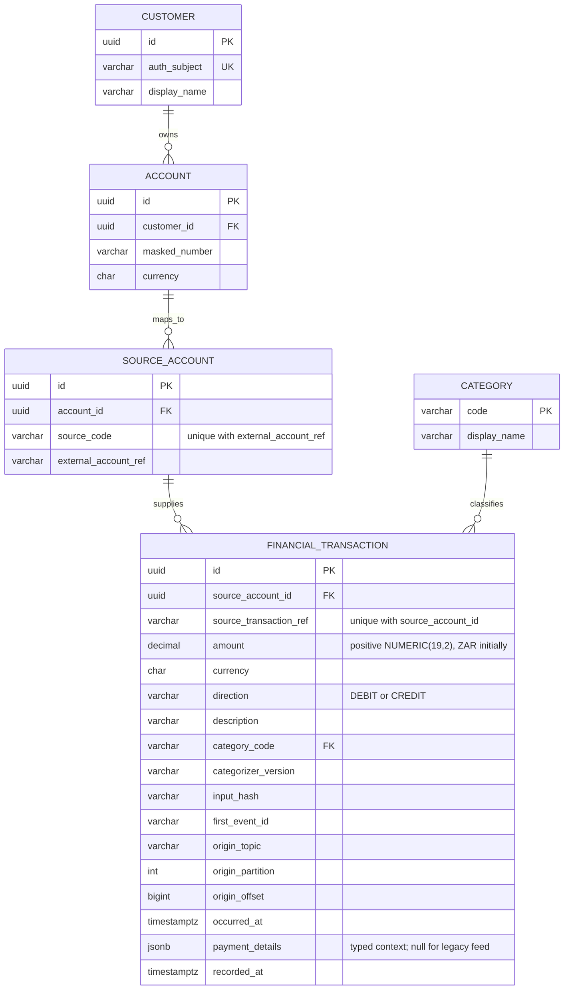
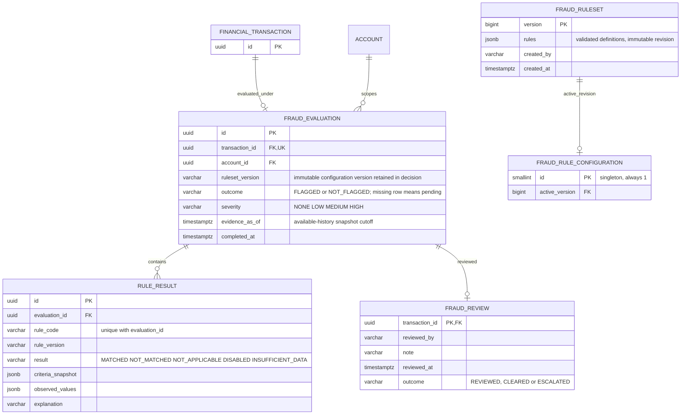
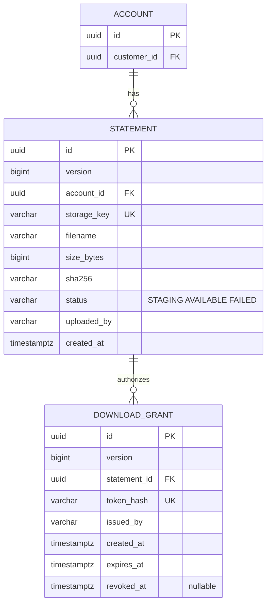

# Data model

The [Liquibase migrations](../backend/src/main/resources/db/changelog/) are the schema source of truth. Diagrams show business fields; framework and maintenance tables are listed below.

## Transactions

## Fraud and reviews

## Statements and download links

## Supporting tables

- `users` and `authorities`: Spring Security credentials and roles. `customer.auth_subject` maps a login to its customer.
- `event_publication`: Spring Modulith durable event delivery records.
- `processing_checkpoint` and `demo_reset_audit`: demo reset/replay control and test provenance.

Transaction identity is unique by source account and provider transaction reference. Amounts use positive `NUMERIC(19,2)` with a separate direction. Each transaction has at most one completed fraud evaluation and one review. Statement and download-grant version columns support Spring Data JDBC persistence.
